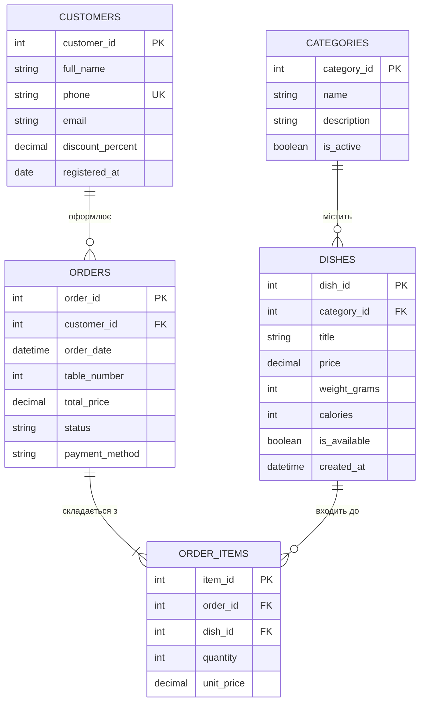
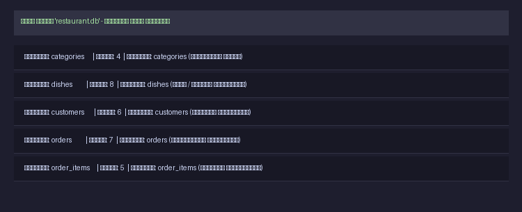
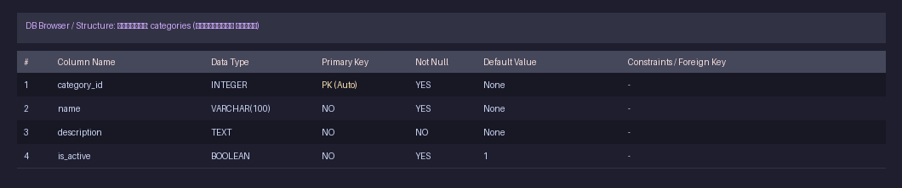
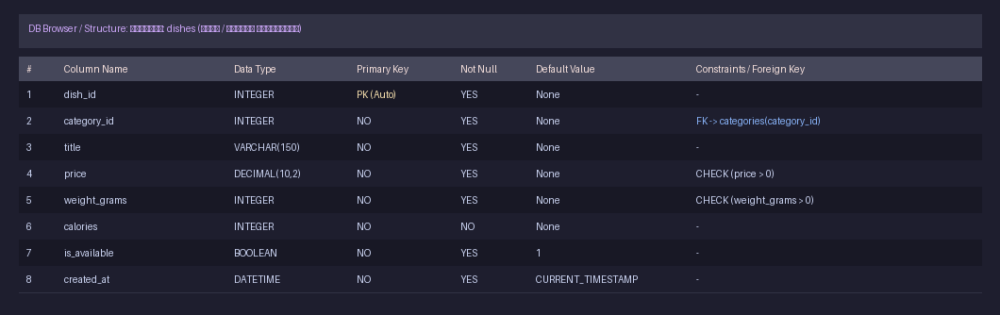
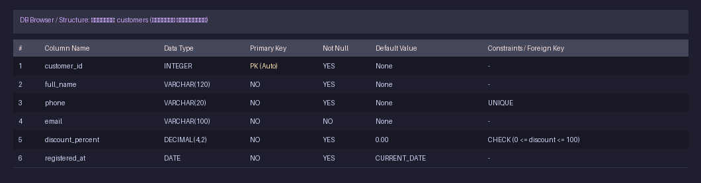
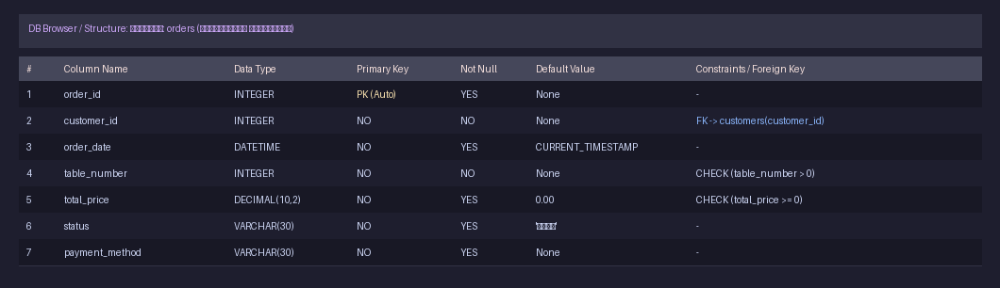
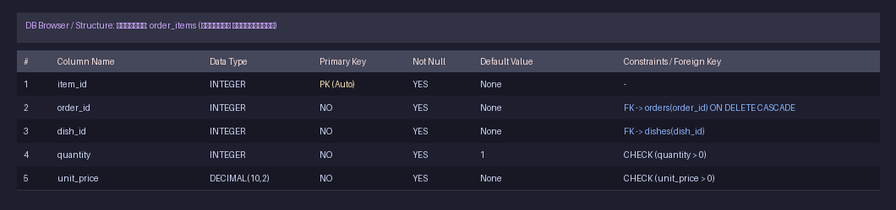

# Завдання 2: Проєктування бази даних інформаційної системи "Ресторан"

## 1. Загальний опис системи

Розроблено реляційну базу даних для автоматизації роботи ресторану (`restaurant.db`). Система покриває процеси ведення меню, категорій страв, обліку постійних клієнтів із програмою лояльності, а також фіксації замовлень та їх деталізації за позиціями.

База даних містить **5 взаємопов'язаних таблиць** (перевищує мінімальну вимогу у 4 таблиці), використовує різноманітні типи даних (`INTEGER`, `VARCHAR`, `TEXT`, `DECIMAL`, `BOOLEAN`, `DATE`, `DATETIME`), первинні ключі (`PRIMARY KEY AUTOINCREMENT`), зовнішні ключі (`FOREIGN KEY`) з каскадними діями та обмеження перевірки (`CHECK`, `UNIQUE`, `NOT NULL`, `DEFAULT`).

---

## 2. ER-діаграма зв'язків (Entity-Relationship Diagram)

---

## 3. Структура таблиць

### 1. Таблиця `categories` (Категорії страв)
| Стовпець | Тип даних | Ключ | Not Null | За замовчуванням | Опис |
|---|---|---|---|---|---|
| `category_id` | `INTEGER` | **PK (Auto)** | Так | auto | Унікальний ідентифікатор категорії |
| `name` | `VARCHAR(100)` | - | Так | - | Назва категорії (Перші страви, Десерти тощо) |
| `description` | `TEXT` | - | Ні | NULL | Опис категорії |
| `is_active` | `BOOLEAN` | - | Так | 1 | Статус активності категорії в меню |

### 2. Таблиця `dishes` (Меню / Страви ресторану)
| Стовпець | Тип даних | Ключ | Not Null | За замовчуванням | Опис та обмеження |
|---|---|---|---|---|---|
| `dish_id` | `INTEGER` | **PK (Auto)** | Так | auto | Унікальний ідентифікатор страви |
| `category_id` | `INTEGER` | **FK** | Так | - | Зв'язок із `categories(category_id)` |
| `title` | `VARCHAR(150)` | - | Так | - | Назва страви |
| `price` | `DECIMAL(10, 2)`| - | Так | - | Ціна страви (`CHECK (price > 0)`) |
| `weight_grams` | `INTEGER` | - | Так | - | Вага у грамах (`CHECK (weight_grams > 0)`) |
| `calories` | `INTEGER` | - | Ні | NULL | Калорійність порції (ккал) |
| `is_available` | `BOOLEAN` | - | Так | 1 | Доступність для замовлення |
| `created_at` | `DATETIME` | - | Так | `CURRENT_TIMESTAMP` | Дата та час внесення в меню |

### 3. Таблиця `customers` (Клієнти)
| Стовпець | Тип даних | Ключ | Not Null | За замовчуванням | Опис та обмеження |
|---|---|---|---|---|---|
| `customer_id` | `INTEGER` | **PK (Auto)** | Так | auto | Унікальний код клієнта |
| `full_name` | `VARCHAR(120)` | - | Так | - | ПІБ клієнта |
| `phone` | `VARCHAR(20)` | **UNIQUE** | Так | - | Номер телефону |
| `email` | `VARCHAR(100)` | - | Ні | NULL | Електронна пошта |
| `discount_percent`| `DECIMAL(4, 2)`| - | Так | 0.00 | Знижка у % (`CHECK (0 <= discount <= 100)`) |
| `registered_at` | `DATE` | - | Так | `CURRENT_DATE` | Дата реєстрації в системі лояльності |

### 4. Таблиця `orders` (Замовлення)
| Стовпець | Тип даних | Ключ | Not Null | За замовчуванням | Опис та обмеження |
|---|---|---|---|---|---|
| `order_id` | `INTEGER` | **PK (Auto)** | Так | auto | Номер замовлення (чеку) |
| `customer_id` | `INTEGER` | **FK** | Ні | NULL | Посилання на `customers(customer_id)` (або гість) |
| `order_date` | `DATETIME` | - | Так | `CURRENT_TIMESTAMP` | Дата і час відкриття замовлення |
| `table_number` | `INTEGER` | - | Ні | NULL | Номер столика (`CHECK (table_number > 0)`) |
| `total_price` | `DECIMAL(10, 2)`| - | Так | 0.00 | Підсумкова сума замовлення |
| `status` | `VARCHAR(30)` | - | Так | 'Нове' | Статус: Нове, Готується, Виконано, Скасовано |
| `payment_method` | `VARCHAR(30)` | - | Так | - | Спосіб оплати (Готівка, Безготівковий) |

### 5. Таблиця `order_items` (Позиції замовлення — Many-to-Many)
| Стовпець | Тип даних | Ключ | Not Null | За замовчуванням | Опис та обмеження |
|---|---|---|---|---|---|
| `item_id` | `INTEGER` | **PK (Auto)** | Так | auto | Унікальний ідентифікатор позиції |
| `order_id` | `INTEGER` | **FK** | Так | - | Посилання на `orders(order_id)` (`ON DELETE CASCADE`) |
| `dish_id` | `INTEGER` | **FK** | Так | - | Посилання на `dishes(dish_id)` |
| `quantity` | `INTEGER` | - | Так | 1 | Кількість порцій (`CHECK (quantity > 0)`) |
| `unit_price` | `DECIMAL(10, 2)`| - | Так | - | Ціна за одиницю на момент замовлення |

---

## 4. Знімки екрана зі структурою таблиць (Screenshots)

Знімки структури таблиць бази даних сформовано та розміщено у каталозі `screenshots/`:

1. **Загальний огляд таблиць бази даних:**  
   

2. **Структура таблиці `categories`:**  
   

3. **Структура таблиці `dishes`:**  
   

4. **Структура таблиці `customers`:**  
   

5. **Структура таблиці `orders`:**  
   

6. **Структура таблиці `order_items`:**  
   

---

## 5. Файли проєкту

- `schema.sql` — DDL-скрипт створення таблиць, зв'язків та обмежень.
- `seed.sql` — DML-скрипт тестового наповнення бази даними.
- `restaurant.db` — готова SQLite база даних.
- `build_db.py` — скрипт збірки бази даних із SQL-файлів.
- `generate_screenshots.py` — скрипт генерації зображень структури таблиць.
- `dz/Program.cs` — C# програма для інспектування структури таблиць через `Microsoft.Data.Sqlite`.
