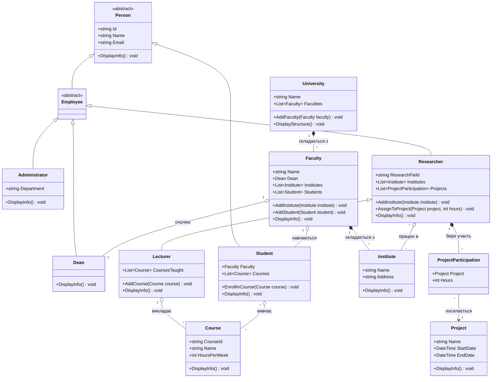
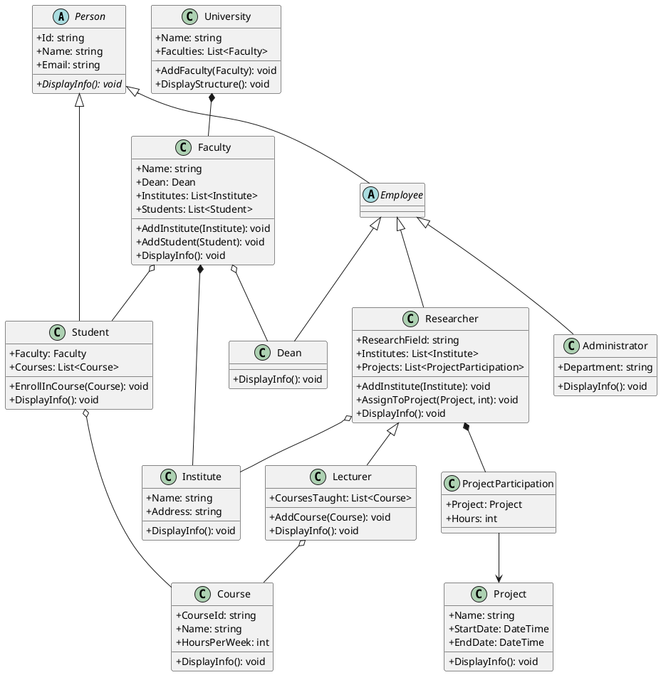

# Завдання 1: UML-діаграма класів та об'єктна модель "Університет"

## 1. Обґрунтування абстрактних класів

У даній предметній області визначено два класи, які доцільно зробити **абстрактними (`abstract`)**:

1. **`Person` (Людина / Особа)** — базовий абстрактний клас для всіх фізичних осіб в університеті (`Employee` та `Student`). В реальній системі не існує просто "особи" без певної ролі — кожен є або співробітником, або студентом. Клас містить спільні поля: `Id`, `Name`, `Email` та абстрактний метод `DisplayInfo()`.
2. **`Employee` (Працівник)** — базовий абстрактний клас для всього персоналу університету. Співробітник завжди належить до конкретної посадової категорії: дослідник/пошукувач (`Researcher`), адміністратор (`Administrator`) або декан (`Dean`).

---

## 2. UML-діаграма класів (Mermaid)

---

## 3. PlantUML код діаграми (для PlantUML / draw.io)

---

## 4. Опис ієрархії та зв'язків між класами

- **Наслідування (Inheritance):**
  - `Person` -> `Employee`, `Student`
  - `Employee` -> `Administrator`, `Dean`, `Researcher`
  - `Researcher` -> `Lecturer` (лектор є дослідником, який додатково викладає курси)
- **Композиція (Composition):**
  - `University` містить `Faculty` (факультет не існує окремо від університету).
  - `Faculty` містить `Institute` (кафедри/інститути належать факультету).
  - `Researcher` володіє записами участі в проектах `ProjectParticipation`.
- **Агрегація / Асоціація (Aggregation / Association):**
  - `Faculty` асоціюється з `Dean` (декан призначається на факультет).
  - `Researcher` асоціюється з `Institute` (пошукувач може працювати в кількох інститутах).
  - `Lecturer` веде перелік курсів `Course`.
  - `Student` вивчає перелік курсів `Course` та прикріплений до `Faculty`.
