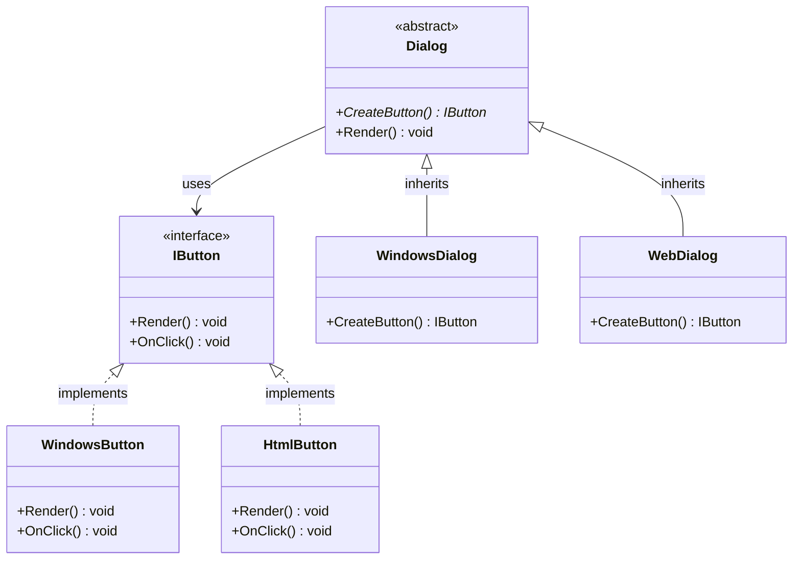

# Патерн проєктування: Фабричний метод (Factory Method)

Реалізація прикладу крос-платформового діалогового вікна та елементів інтерфейсу (кнопок) мовою C#.

## 1. Опис патерну

**Фабричний метод** — це породжувальний патерн проєктування, який визначає спільний інтерфейс для створення об'єктів у суперкласі, дозволяючи підкласам змінювати тип створюваних об'єктів.

У цьому прикладі:
- `IButton` — загальний інтерфейс для кнопок (`Render()`, `OnClick()`).
- `WindowsButton` та `HtmlButton` — конкретні реалізації під Windows та Web.
- `Dialog` — базовий абстрактний клас, який містить фабричний метод `CreateButton()` та викликає його у методі `Render()`.
- `WindowsDialog` та `WebDialog` — конкретні класи вікон, які повертають відповідні кнопки.

---

## 2. UML-діаграма класів

